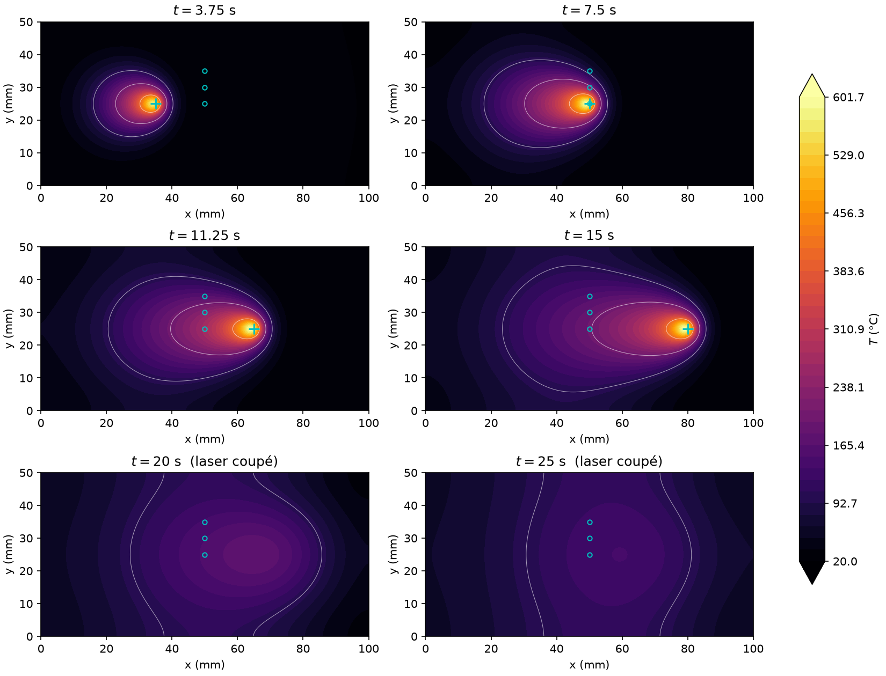

# Transient heat equation with FEniCSx (DOLFINx 0.11)

A finite element solver for the heat equation with a θ time scheme. The code is **verified** with
manufactured solutions, then used to model a steel plate heated by a moving laser.

$$
\frac{\partial u}{\partial t} - \nabla\cdot(\kappa \nabla u) + \beta\,(u-u_a) = f,
\qquad
(M + \theta\Delta t K)\,U^{n+1} = (M - (1-\theta)\Delta t K)\,U^n + \Delta t\,F^{n+\theta}
$$

Full report (in French): [`report/rapport.pdf`](report/rapport.pdf).

## Main results

| Study | Result |
|---|---|
| Convergence in space (P1, P2, P3) | $L^2$ orders: 2.00 / 3.00 / 4.01. $H^1$ orders: 1.00 / 2.00 / 3.00 |
| Convergence in time | backward Euler: 1.00. Crank–Nicolson: 2.00 |
| Forward Euler stability | limit $\Delta t_c = 2/\lambda_{\max}$ computed (SciPy `eigsh`) and confirmed: stable at $0.95\,\Delta t_c$, blows up at $1.05\,\Delta t_c$ |
| L-stability | Crank–Nicolson gives oscillations and negative values on discontinuous data; backward Euler stays positive |
| Laser case | discrete energy balance exact to $4\cdot10^{-13}$, peak of 601.7 °C converged to ~0.05 %, MPI results identical to serial |
| Strong scaling (i5-12450HX, 180,901 dofs, CG + AMG) | speedup 1.86 on 2 processes, 3.12 on 4, then 2.46 on 8, most likely because the hybrid CPU's slower E-cores set the pace (see `results/figures/scaling.png`) |



## Layout

```
heat/solver.py                     general θ-scheme solver (Dirichlet, Neumann, Robin, volume exchange)
heat/manufactured.py               manufactured solutions
scripts/study_space.py             convergence in space
scripts/study_time.py              convergence in time
scripts/study_stability.py         forward Euler CFL limit + Crank–Nicolson oscillations
scripts/laser.py                   moving laser source (MPI, XDMF output for ParaView)
scripts/study_laser_convergence.py mesh / time-step independence + MPI tests
scripts/study_scaling.py           strong scaling study (1 to 8 processes, repeated runs)
report/make_tables.py              report tables built from results/
report/rapport.tex                 LaTeX report
```

## How to reproduce

```bash
conda env create -f environment.yml && conda activate fenicsx-heat
./run_all.sh                                   # all studies (~10 min on 2 cores)
cd scripts && mpirun -n 4 python laser.py --nx 400 --solver cg   # in parallel
cd ../report && python make_tables.py && latexmk -pdf rapport.tex
```

Or with Docker: `docker run -ti -v $(pwd):/root/shared -w /root/shared dolfinx/dolfinx:stable`.

Open the temperature field `results/laser.xdmf` in ParaView (reader *Xdmf3ReaderT*).
